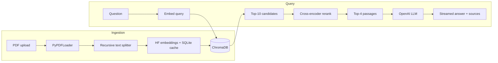

# Enterprise Document Q&A Assistant (RAG)

A retrieval-augmented generation (RAG) service that answers questions about your PDF documents, with **page-level citations**, **streaming responses** and a **measurable evaluation harness**.

Built with **LangChain, ChromaDB, Hugging Face embeddings, the OpenAI API and FastAPI**.

## Highlights

- **End-to-end RAG pipeline**: PDF loading, recursive chunking, embedding and semantic search in ChromaDB.
- **Two-stage retrieval**: vector search pulls 10 candidates, then a cross-encoder reranks them down to the best 4.
- **Grounded answers**: the prompt forces the model to answer only from retrieved passages, cite them as `[1]`, `[2]`, and refuse when the answer is not in the documents.
- **Embedding cache**: a persistent SQLite cache means unchanged text is never embedded twice (re-ingestion, repeated questions).
- **Streaming**: Server-Sent Events deliver tokens as they are generated, cutting time-to-first-token.
- **Reproducible evaluation**: scripts to build a question set, score accuracy with an LLM judge, and benchmark latency.
- **Idempotent ingestion**: deterministic chunk IDs mean re-uploading a file never creates duplicates.
- **Dockerised** and covered by unit tests.

## Architecture



## Project structure

```
enterprise-rag-assistant/
├── app/
│   ├── config.py        # settings from environment variables
│   ├── embeddings.py    # Hugging Face embeddings + SQLite cache
│   ├── ingest.py        # load -> chunk -> embed -> store (CLI + API)
│   ├── retriever.py     # vector search + cross-encoder reranking
│   ├── rag.py           # prompts, blocking and streaming generation
│   ├── history.py       # query history (SQLite)
│   └── main.py          # FastAPI application
├── eval/
│   ├── generate_eval_set.py   # draft a question set from your PDFs
│   ├── evaluate.py            # accuracy: baseline vs each tuning step
│   └── benchmark_latency.py   # latency: cache and streaming
├── tests/               # unit tests (pytest)
├── data/pdfs/           # put your PDFs here (git-ignored)
├── Dockerfile
├── requirements.txt
└── .env.example
```

## Quick start

**Requirements:** Python 3.10+, an [OpenAI API key](https://platform.openai.com/api-keys). Embeddings and reranking run locally, so no extra key is needed for them.

```bash
# 1. Clone and enter the project
git clone https://github.com/muhammadammar5/Enterprise-Rag-Assistant.git
cd Enterprise-Rag-Assistant

# 2. Create a virtual environment
python -m venv .venv
source .venv/bin/activate        # Windows: .venv\Scripts\activate

# 3. Install dependencies
pip install -r requirements.txt

# 4. Configure your key
cp .env.example .env             # Windows: copy .env.example .env
# open .env and set OPENAI_API_KEY

# 5. Add PDFs to data/pdfs/, then index them
python -m app.ingest --dir data/pdfs

# 6. Start the API
uvicorn app.main:app --reload
```

Interactive API docs: <http://localhost:8000/docs>

> The first run downloads two small models (about 120 MB total) from Hugging Face.

## API

| Method | Endpoint        | Description                                   |
|--------|-----------------|-----------------------------------------------|
| GET    | `/health`       | Service status, indexed chunk count, cache stats |
| POST   | `/upload`       | Upload and index a PDF                        |
| POST   | `/query`        | Ask a question, get the full answer at once   |
| POST   | `/query/stream` | Ask a question, stream tokens (SSE)           |
| GET    | `/history`      | Recent questions with answers and latency     |

```bash
# Upload a document
curl -X POST http://localhost:8000/upload -F "file=@data/pdfs/report.pdf"

# Ask a question
curl -X POST http://localhost:8000/query \
  -H "Content-Type: application/json" \
  -d '{"question": "What is the warranty period?"}'

# Stream the answer (-N disables curl buffering)
curl -N -X POST http://localhost:8000/query/stream \
  -H "Content-Type: application/json" \
  -d '{"question": "What is the warranty period?"}'
```

Example `/query` response:

```json
{
  "answer": "The warranty period is 24 months from the date of purchase [1].",
  "sources": [
    {"source": "policy.pdf", "page": 12, "snippet": "The warranty period for all hardware is 24 months..."}
  ],
  "timings": {"retrieval_ms": 41.2, "total_ms": 1630.8}
}
```

## Evaluation

The numbers below come from the scripts in `eval/`. Anyone can reproduce them on their own documents.

```bash
# 1. Draft ~50 questions from your PDFs, then REVIEW AND FIX THEM BY HAND
python -m eval.generate_eval_set --n 50

# 2. Accuracy: baseline vs each tuning step
python -m eval.evaluate

# 3. Latency: with and without caching and streaming
python -m eval.benchmark_latency --n 20
```

### How accuracy is measured

Each question has a reference answer. The system answers it, and an LLM judge (temperature 0) decides whether the answer matches the reference. The configurations are cumulative so the contribution of each change is visible:

| Config         | Chunking          | Retrieval              | Prompt   |
|----------------|-------------------|------------------------|----------|
| `baseline`     | 1500 chars, no overlap | top-3             | plain    |
| `chunk_tuning` | 800 chars, 150 overlap | top-3             | plain    |
| `reranking`    | 800 chars, 150 overlap | top-10 then rerank to 4 | plain |
| `tuned`        | 800 chars, 150 overlap | top-10 then rerank to 4 | refined, grounded |

### Results

> Fill these in with the output of your own runs (see `eval/results.json` and `eval/latency_results.json`).

**Answer accuracy** (N = _50_ questions over _N_ pages of PDFs)

| Config         | Accuracy | Correct |
|----------------|----------|---------|
| `baseline`     | _TBD_    | _TBD_   |
| `chunk_tuning` | _TBD_    | _TBD_   |
| `reranking`    | _TBD_    | _TBD_   |
| `tuned`        | _TBD_    | _TBD_   |

**Latency** (N = _20_ queries)

| Setup                                  | Mean (ms) | p50 (ms) | p95 (ms) |
|----------------------------------------|-----------|----------|----------|
| No cache, blocking (total)             | _TBD_     | _TBD_    | _TBD_    |
| Cache, blocking (total)                | _TBD_     | _TBD_    | _TBD_    |
| Cache + streaming (time to first token)| _TBD_     | _TBD_    | _TBD_    |
| Cache + streaming (total)              | _TBD_     | _TBD_    | _TBD_    |

### Reading the latency results honestly

- The **embedding cache** removes repeated embedding work: re-ingesting documents and repeating questions. Embedding one new question is already fast (tens of milliseconds), so the cache does not change total latency for new questions much.
- **Streaming** does not shorten total generation time. It shortens **time to first token**, which is what the user perceives.

## Configuration

All settings can be overridden in `.env` (see `.env.example`):

| Variable          | Default                                   | Purpose                          |
|-------------------|-------------------------------------------|----------------------------------|
| `OPENAI_API_KEY`  | (required)                                | OpenAI authentication            |
| `LLM_MODEL`       | `gpt-4o-mini`                             | Generation model                 |
| `EMBEDDING_MODEL` | `sentence-transformers/all-MiniLM-L6-v2`  | Local embedding model            |
| `RERANKER_MODEL`  | `cross-encoder/ms-marco-MiniLM-L-6-v2`    | Local reranker                   |
| `CHUNK_SIZE`      | `800`                                     | Characters per chunk             |
| `CHUNK_OVERLAP`   | `150`                                     | Overlap between chunks           |
| `TOP_K_RETRIEVE`  | `10`                                      | Candidates fetched from ChromaDB |
| `TOP_K_FINAL`     | `4`                                       | Passages sent to the LLM         |
| `USE_RERANKER`    | `true`                                    | Toggle reranking                 |
| `CACHE_ENABLED`   | `true`                                    | Toggle the embedding cache       |

If you change `EMBEDDING_MODEL` or the chunk settings, re-index with `python -m app.ingest --dir data/pdfs --reset`.

## Docker

```bash
docker build -t rag-assistant .
docker run -p 8000:8000 --env-file .env \
  -v "$(pwd)/chroma_db:/app/chroma_db" \
  -v "$(pwd)/cache:/app/cache" \
  -v "$(pwd)/data:/app/data" \
  rag-assistant
```

The mounted volumes keep your index and embedding cache between container restarts.

## Tests

```bash
pytest
```

## Design decisions

- **Local embeddings and reranker, hosted LLM.** Retrieval quality and cost stay under your control; only generation uses a paid API.
- **Normalised embeddings.** L2 distance then ranks identically to cosine similarity, with no extra configuration.
- **Rerank after wide retrieval.** Vector search is fast but approximate. A cross-encoder reads query and passage together, which is more accurate but too slow to run over the whole corpus, so it only scores the top candidates.
- **Deterministic chunk IDs.** Re-uploading a document updates it instead of duplicating its chunks.
- **Refusal instead of guessing.** The refined prompt tells the model to say when the documents do not contain the answer.

## Limitations and future work

- Text-only PDFs. Scanned documents need OCR first.
- No conversation memory: each question is answered independently.
- No authentication on the API; add it before any public deployment.
- The LLM judge is a proxy for human grading. Spot-check its verdicts.
- Ideas: hybrid search (BM25 plus vectors), multi-turn chat, per-user document collections, retrieval-quality metrics such as recall@k.

## License

MIT
